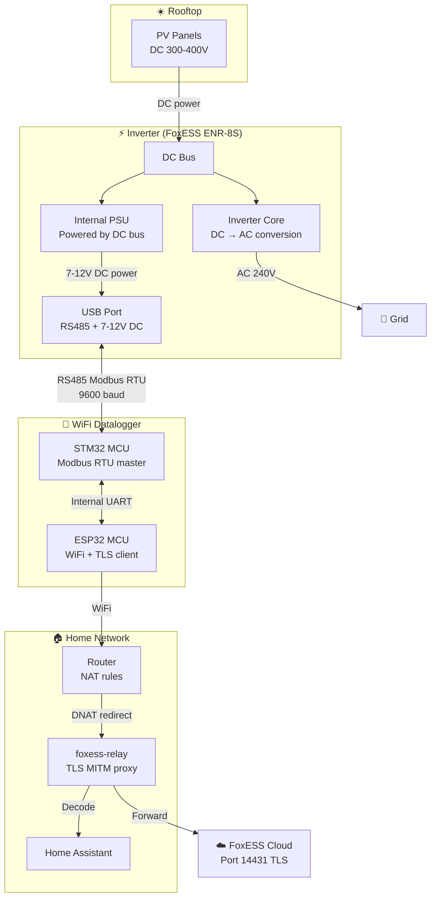

# foxess-local

Local interception and decoding of FoxESS solar inverter data from the WiFi datalogger.

The FoxESS WiFi dongle uploads inverter data to remote monitoring servers over a custom binary protocol on TLS port 14431.
This project intercepts that traffic via a transparent TLS relay, decodes the binary frames, and provides real-time local access to solar production data — without depending on the FoxESS cloud.

## System Architecture



### Why the datalogger goes offline at night

The datalogger is **physically unpowered** overnight — this is not a software sleep mode.

The power chain is:

1. **PV panels** generate DC voltage when there's sunlight.
2. The **DC bus** inside the inverter carries this PV voltage.
3. The inverter's **internal PSU** derives low-voltage power (7–12V DC) from the DC bus.
4. This PSU powers the **USB port** where the datalogger is plugged in.
5. At sunset, PV voltage drops below the inverter's operating threshold (~80V).
6. The inverter shuts down its DC bus — and with it, the internal PSU and USB port.
7. The datalogger **loses power completely** and disconnects from WiFi.

Grid-tied inverters without batteries deliberately shut down at night for two reasons:
- **No purpose**: there is no solar DC to convert to AC.
- **Anti-islanding**: regulatory safety standards (AS/NZS 4777 in Australia, IEEE 1547 globally) require grid-tied inverters to disconnect when they cannot confirm a live grid via their own generation.
The inverter has no separate grid-powered PSU to keep ancillary systems alive.

This means our relay only receives data during daylight hours.
Historical overnight data does not exist — it must be sourced from the grid meter or other sensors.

## How interception works

```
[Dongle] --TLS:14431--> [Router DNAT] --> [foxess-relay] --TLS:14431--> [FoxESS Cloud]
                                               |
                                         [capture log]
                                               |
                                    [foxess-live / foxess-decode]
```

The relay is transparent — the FoxESS cloud still receives all data normally.

## Quick start

```bash
# 1. Copy and fill in your environment config
cp .env.example .env
# Edit .env with your IPs, UniFi token, etc.

# 2. Generate TLS cert (one-time)
mkdir -p certs
openssl req -x509 -newkey rsa:2048 -keyout certs/server.key -out certs/server.pem \
  -days 36500 -nodes -subj "/C=CN/ST=JiangSu/L=Wuxi/O=FoxESS/CN=monitor"

# 3. Install network rules (UniFi API, persistent)
source .env && ./scripts/install.sh

# 4. Start the relay
uv run foxess-relay

# 5. Watch live stats (in another terminal)
uv run foxess-live
```

## Commands

| Command | Description |
|---------|-------------|
| `uv run foxess-relay` | Start the TLS relay (captures to `captures/`) |
| `uv run foxess-live` | Live dashboard — updates every ~90s |
| `uv run foxess-live --once` | Print latest reading and exit |
| `uv run foxess-decode captures/` | Decode all captured data frames |
| `uv run foxess-decode captures/ --latest --json` | Latest reading as JSON |
| `./scripts/install.sh` | Create UniFi NAT rules (requires `source .env`) |
| `./scripts/uninstall.sh` | Remove UniFi NAT rules |

## Network setup

The dongle connects to a hardcoded IP (not hostname) on port 14431.
To intercept:

1. **DNAT rule**: redirect the dongle's outbound traffic to the relay host
2. **MASQUERADE rule**: hairpin NAT fix when relay is on the same subnet

Both rules are managed via the **UniFi Network API** (persistent, no SSH required).
See `scripts/install.sh` for the exact API calls, or create manually in UniFi UI under **Policy Engine → NAT → Dest.
NAT**.

For non-UniFi routers, equivalent `iptables` rules:
```bash
iptables -t nat -A PREROUTING -s $DONGLE_IP -p tcp --dport 14431 -j DNAT --to-destination $RELAY_HOST
iptables -t nat -A POSTROUTING -s $DONGLE_IP -d $RELAY_HOST -p tcp --dport 14431 -j MASQUERADE
```

## Protocol

See [ANALYSIS.md](ANALYSIS.md) for the full protocol documentation.

## Development

- WSL-specific notes: [docs/wsl-dev-notes.md](docs/wsl-dev-notes.md)
- Environment template: [.env.example](.env.example)
